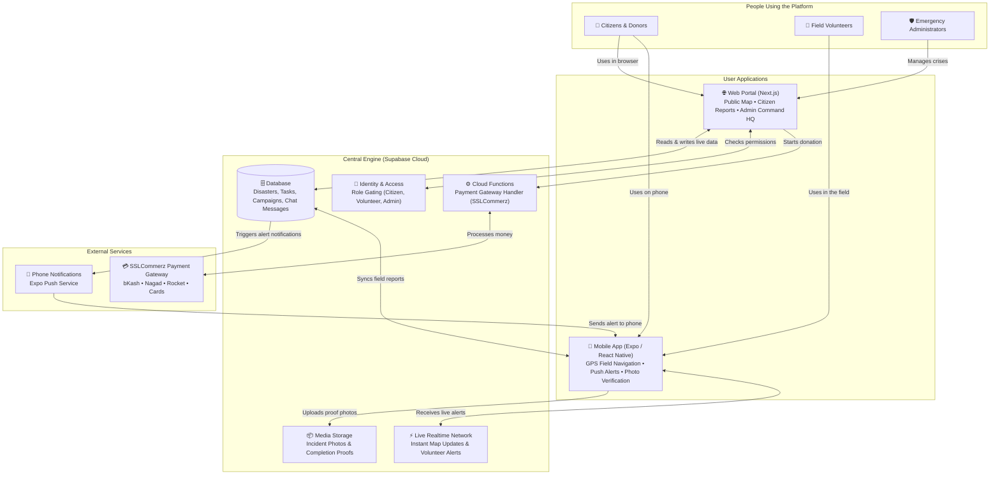

# 🚨 CrisisLink

### Connected Disaster Management, Volunteer Response & Relief Donation Platform

> **CrisisLink** is an all-in-one digital relief network that connects **citizens facing emergencies**, **on-the-ground volunteer teams**, and **disaster management authorities** into one unified, real-time coordination hub.

---

## 📖 Table of Contents
1. [What is CrisisLink?](#-what-is-crisislink)
2. [The Problem We Solve](#-the-problem-we-solve)
3. [Who Uses CrisisLink? (Roles at a Glance)](#-who-uses-crisislink-roles-at-a-glance)
4. [How Everything Connects (System Architecture)](#-how-everything-connects-system-architecture)
5. [Why We Use Supabase (The Central Engine)](#-why-we-use-supabase-the-central-engine)
6. [A Real-World Example: How CrisisLink Works in a Disaster](#-a-real-world-example-how-crisislink-works-in-a-disaster)
7. [Core Platform Features](#-core-platform-features)
8. [Project Layout (Where Everything Lives)](#-project-layout-where-everything-lives)
9. [How to Run CrisisLink on Your Computer](#-how-to-run-crisislink-on-your-computer)
10. [Tested & Verified Reliability](#-tested--verified-reliability)

---

## 💡 What is CrisisLink?

When a flood, cyclone, fire, or earthquake strikes, every second matters. Traditional emergency response often struggles with:
- **Chaotic information** on social media with no way to verify what is real and what is outdated.
- **Volunteers arriving blindly** without knowing where help is needed most or who is already working on it.
- **Relief donors hesitating** because they do not know whether their money will reach actual victims.

**CrisisLink bridges these gaps.** It provides a **web portal** for the public and administrators, alongside a **mobile app** for volunteers in the field, all synchronized in real time through a secure cloud backend.

---

## 🎯 The Problem We Solve

| Before CrisisLink (Traditional Chaos) | With CrisisLink (Structured & Real-Time) |
| :--- | :--- |
| People post scattered cries for help on Facebook with no exact GPS location. | Citizens report emergencies with one tap, including **exact GPS map coordinates** and photo evidence. |
| Multiple volunteer groups duplicate work in the same easy-to-reach area while remote areas are neglected. | Nearby vetted volunteers receive **automatic proximity alerts** and dispatched task assignments. |
| Fake rumors and false alarms divert emergency services away from real victims. | Community reports are quickly **verified with photo proof** by local volunteers before dispatching major aid. |
| Donors cannot see where relief funds go. | Public campaigns show a **live collection meter** powered by official payment gateway integration. |

---

## 👥 Who Uses CrisisLink? (Roles at a Glance)

CrisisLink is tailor-made for three main groups of people:

### 1. 🧍 The Everyday Citizen
- **Report an Incident:** Pin a disaster (flood, fire, collapse) on the live map with photos and a quick description.
- **Explore Safe Zones:** View a live map showing verified danger zones, nearby relief shelters, and medical camps.
- **Donate to Causes:** Safely contribute relief funds (BDT) via mobile banking (bKash, Nagad) or cards to verified relief campaigns.

### 2. 🤝 The Field Volunteer
- **Instant Proximity Alerts:** Get notified on your phone when a disaster is reported within your local area.
- **Accept Rescue & Aid Tasks:** Receive direct relief missions (e.g., "Deliver 50 food packets to school shelter") with a 30-second acceptance timer.
- **Submit Proof of Work:** Take a photo when aid is delivered to mark tasks complete and maintain full transparency.
- **Team Comms:** Coordinate in real time with fellow volunteers via dedicated incident channels.

### 3. 🛡️ The Disaster Management Admin
- **Triage Command Center:** Review incoming citizen reports, check volunteer verification notes, and confirm incidents.
- **Volunteer Vetting:** Review volunteer applications and national ID checks before approving them for field duties.
- **Regional Emergency Broadcasts:** Send high-priority red alert warnings to all active responders in a specific district.

---

## 🏗️ How Everything Connects (System Architecture)

Here is a clear, bird's-eye view of how CrisisLink's components work together:



---

## 🧠 Why We Use Supabase (The Central Engine)

Instead of maintaining a slow and complicated custom server, CrisisLink uses **Supabase** as its central powerhouse. Here is what each piece does in plain terms:

1. **The Database (PostgreSQL) — "The Platform's Memory"**
   - Keeps track of every disaster report, task assignment, volunteer profile, and donation.
   - It has built-in smart location rules: if a citizen reports an emergency, the database automatically identifies which approved volunteers are within **100 km** of the coordinates.
   - It automatically checks if two people report the same accident within **200 meters** of each other so responders don't get sent twice.

2. **Row Level Security (RLS) — "The Digital Guard"**
   - Ensures privacy and data protection directly at the database level.
   - Example: A citizen can only see their own private donation receipt, while only vetted volunteers can update field verification notes. Nobody can tamper with other people's data.

3. **Realtime System (WebSockets) — "The Live Broadcaster"**
   - Whenever an admin confirms a new flood warning or a volunteer accepts a mission, the changes appear on everyone's screens **instantly without needing to refresh the page**.

4. **Object Storage (`disaster-media`) — "The Evidence Vault"**
   - A secure cloud storage space that holds all uploaded photos and videos.
   - When a citizen takes a photo of broken river embankments or a volunteer takes a picture delivering medical supplies, the images are stored here and securely linked to the map pin.

5. **Serverless Functions — "The Cashier & Accountant"**
   - Runs payment logic for Bangladesh's **SSLCommerz** gateway.
   - It makes sure that donations in Bangladeshi Taka (BDT) are officially verified with the bank before updating the public campaign meter.

---

## 🌊 A Real-World Example: How CrisisLink Works in a Disaster

To see how everything comes together, follow this real-world scenario:

```
[Day 1, 09:00 AM] 
Heavy monsoon rains cause the Surma River in Sylhet to overflow.
```

1. **Step 1: Citizen Reports Incident**
   - Rahim, a local resident, opens CrisisLink on his phone. He taps **"Report Crisis"**, takes a photo of flooded homes, and his phone's GPS automatically marks his location in Kazirbazar, Sylhet.
2. **Step 2: Proximity Alert Fired**
   - The system checks for duplicate reports within 200m. Finding none, it saves the pin and alerts all approved volunteers within 100 km.
3. **Step 3: Ground Volunteer Verifies**
   - Sumon, a registered volunteer living 1.5 km away, receives a push alert on his mobile app. He arrives on site, reviews the water level, and taps **"Verify Incident"** with a fresh verification photo.
4. **Step 4: Admin Dispatches Tasks**
   - At the District Operations HQ, the Admin sees the verified red pin. The Admin creates a task: *"Distribute 100 water purification kits at the primary school."*
5. **Step 5: Rapid Acceptance & Proof**
   - Nearby volunteers have 30 seconds to accept the task. Sumon accepts, picks up supplies from the designated relief center, distributes them to affected families, and snaps a photo of the completed distribution to close the task.
6. **Step 6: Public Relief Funding**
   - An active fundraising campaign on the CrisisLink website for *"Sylhet Flood Relief"* receives donations from donors across the country via bKash and cards. As soon as a donation succeeds, the campaign progress bar updates immediately.

---

## ⭐ Core Platform Features

- 🗺️ **Live Incident Map**: Color-coded emergency markers (Flood, Cyclone, Fire, Earthquake) with severity badges (Critical, High, Medium, Low).
- 📍 **Smart Duplicate Prevention**: Automatic grouping of reports in the same 200-meter zone to eliminate redundant emergency dispatches.
- ⏱️ **30-Second Task SLA**: Ensures quick volunteer mobilization; unaccepted tasks automatically re-route to other nearby helpers.
- 📸 **Proof-of-Work Verification**: Volunteers upload photographic evidence before marking emergency aid as delivered.
- 💳 **Secure SSLCommerz Donations**: Direct integration with Bangladeshi mobile banking (bKash, Nagad, Rocket) and debit/credit cards.
- 📴 **Offline Mobile Support**: When cellular networks are unstable, volunteer reports and chat messages are saved locally and synced as soon as service returns.
- 🔒 **Hidden Admin Operations HQ**: Administrative dashboards run on obscure, protected URLs to prevent unauthorized tampering.

---

## 📁 Project Layout (Where Everything Lives)

The CrisisLink workspace is neatly organized into dedicated folders:

```
crisislink/
├── README.md             # This guide you are reading right now
├── TEST_SUITE_REPORT.md  # Detailed verification report of all platform tests
│
├── web/                  # 🌐 Next.js Web Application
│   ├── src/app/          # Web pages (Home, Map, Citizen Portal, Admin HQ)
│   ├── src/components/   # Buttons, navigation bars, map overlays
│   └── src/proxy.ts      # Security guard ensuring users only see pages for their role
│
├── mobile/               # 📱 Expo React Native Mobile App
│   ├── src/app/          # Mobile screens (Auth, Alerts, Task Manager, Chat)
│   ├── src/services/     # Connectors to the database and payment gateway
│   └── src/store/        # App state management
│
├── supabase/             # 🗄️ Backend Cloud Database
│   ├── migrations/       # Database tables, location rules, and security policies
│   └── functions/        # Payment processing functions for SSLCommerz
│
└── testing/              # 🧪 Automated Quality & Test Suite
    ├── api/              # API and database rule tests
    ├── ui/               # Web and mobile interface checks
    ├── performance/      # Speed and high-traffic load simulations
    ├── security/         # Security and anti-fraud tests
    └── uat/              # Real-world disaster scenario simulations
```

---

## 🚀 How to Run CrisisLink on Your Computer

If you want to run and test the project locally, follow these simple steps:

### Prerequisites
Make sure you have installed on your computer:
- **Node.js** (Version 18 or 20): [Download Node.js](https://nodejs.org/)
- For testing the mobile app: Install the free **Expo Go** app on your physical Android or iPhone from Google Play Store or Apple App Store.

---

### Step 1: Install Dependencies
Open your computer terminal in the `crisislink` folder and run:

```bash
# Install Web dependencies
cd web
npm install

# Install Mobile dependencies
cd ../mobile
npm install
```

---

### Step 2: Start the Web App
From the `web` folder:

```bash
npm run dev
```
Open **[http://localhost:3000](http://localhost:3000)** in your browser to view the CrisisLink website!

---

### Step 3: Start the Mobile App
Open a new terminal window, go into the `mobile` folder, and run:

```bash
cd mobile
npx expo start
```
- A large **QR Code** will appear in your terminal.
- Open the **Expo Go** app on your phone, tap **Scan QR Code**, and point your camera at the screen. The CrisisLink mobile app will open right on your device!

---

### Step 4: Run the Complete Test Suite
To verify that every part of the system is functioning without errors:

```bash
cd testing
npm test
```
All **45 automated tests** across API, UI, Performance, Security, and Real-World Scenarios will run and output their pass status in seconds.

---

## 🛡️ Tested & Verified Reliability

CrisisLink has been rigorously tested using an end-to-end testing suite:
- ✅ **API Testing**: Validated incident submissions, coordinate formulas, and payment callbacks.
- ✅ **UI Testing**: Checked form validation, volunteer countdown timers, and admin screens.
- ✅ **Performance**: Handles bursts of **1,000+ incident reports in under 1 second** and 10,000 location checks in under 3 milliseconds.
- ✅ **Security**: Passed database isolation tests, SQL injection checks, XSS defenses, and payment signature tampering checks.
- ✅ **UAT Scenarios**: 5 realistic humanitarian disaster scenarios executed from start to finish.

For complete test logs and metrics, read the full [TEST_SUITE_REPORT.md](TEST_SUITE_REPORT.md).

---

## 🤝 Summary

CrisisLink transforms disaster response from fragmented confusion into an organized, transparent, and technology-driven humanitarian effort. Whether you are a citizen needing help, a volunteer responding on the frontlines, or a donor contributing from afar, CrisisLink ensures that aid reaches the right place at the right time.
